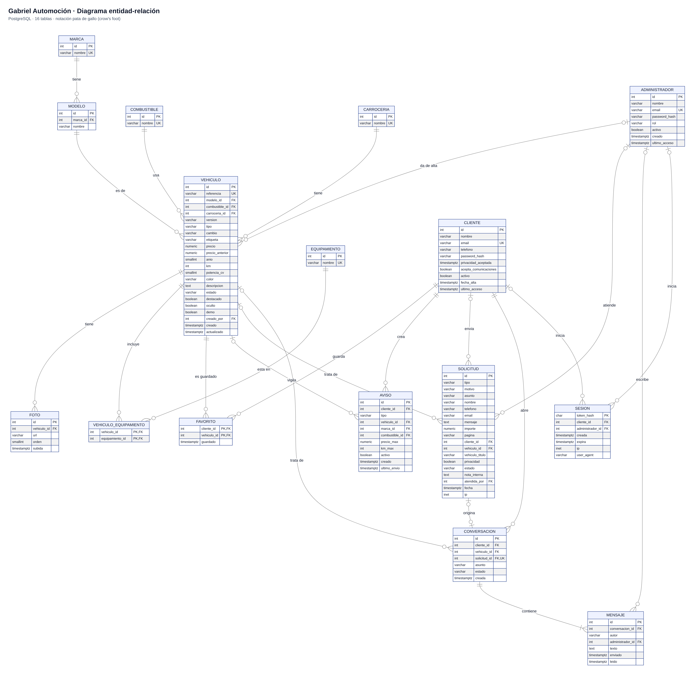
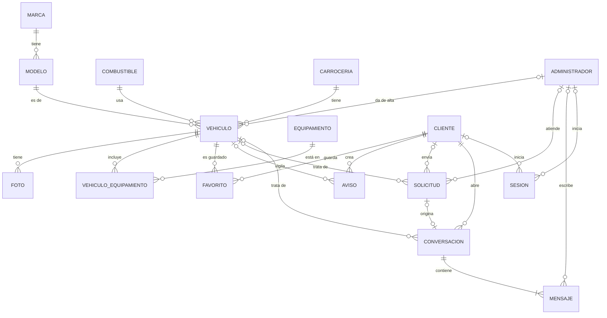

# Base de datos de Gabriel Automoción

Diseño relacional de la web del concesionario: el stock de vehículos que ya gestiona el panel, las solicitudes de los formularios, y lo que falta por construir según la planificación (cuentas de clientes, guardados, avisos y mensajes).

SGBD elegido: **PostgreSQL 16**. Es gratuito, cumple el estándar SQL, tiene restricciones `CHECK`, disparadores y vistas, y se puede usar en la nube gratis con Neon (la base de datos que ofrece Vercel, donde ya está publicada la web).

## Archivos

| Archivo | Qué contiene |
| --- | --- |
| [`01_esquema.sql`](01_esquema.sql) | Creación de las 16 tablas con sus claves, restricciones, índices, 2 disparadores y 2 vistas |
| [`02_datos.sql`](02_datos.sql) | Datos de ejemplo: los 14 vehículos de la web (con fotos y equipamiento), 2 administradores, 3 clientes, solicitudes y una conversación |
| [`03_consultas.sql`](03_consultas.sql) | 12 consultas que necesita cada pantalla de la web (catálogo, ficha, panel, Mi cuenta, mensajes…) |
| [`04_pruebas.sql`](04_pruebas.sql) | 17 pruebas de integridad: datos que la base de datos debe rechazar y comprobación de los disparadores |
| [`generar_datos.js`](generar_datos.js) | Genera `02_datos.sql` a partir de `js/demo-data.js`, para que la base de datos y la web tengan el mismo stock |
| [`diagrama-er.png`](diagrama-er.png) | Diagrama entidad-relación con todos los campos, para la memoria (fuente en `diagrama-er.mmd`) |

## Cómo probarlo

```bash
createdb gabriel
psql -d gabriel -f bd/01_esquema.sql     # crea las tablas (se puede repetir: borra y recrea)
psql -d gabriel -f bd/02_datos.sql       # carga los datos de ejemplo
psql -d gabriel -f bd/03_consultas.sql   # lanza las consultas de la web
psql -d gabriel -f bd/04_pruebas.sql     # debe mostrar 17 líneas «OK» y no cambia nada
```

Contraseña de todas las cuentas de ejemplo: `demo1234` (guardada con scrypt, nunca en claro).

## Modelo entidad-relación





### Entidades

**Catálogo**

- **Vehículo**: cada coche del stock. Se identifica internamente por un número (`id`) y de cara al cliente por su referencia (`GA-1001`), que es única. Guarda precio, precio anterior (para mostrar la rebaja), año, kilómetros, potencia, color, etiqueta DGT, tipo (ocasión, seminuevo, km 0, nuevo), estado (disponible, reservado, vendido) y si está destacado, oculto o es de demostración.
- **Marca** y **Modelo**: un modelo pertenece a una marca (1:N). Separarlos evita escribir «Volkswagen» de diez formas distintas y permite filtrar por marca.
- **Combustible** y **Carrocería**: listas de valores que el concesionario puede ampliar.
- **Foto**: un coche tiene muchas fotos (1:N), con un orden. La de orden 1 es la portada.
- **Equipamiento**: un extra («Faros LED») lo tienen muchos coches y un coche tiene muchos extras. Es una relación N:M, que se resuelve con la tabla intermedia **vehiculo_equipamiento**.

**Personas**

- **Administrador**: el personal que entra en el panel. Tiene rol `propietario` o `gestor`.
- **Cliente**: quien se registra en la web. El correo es único sin distinguir mayúsculas y se guarda cuándo aceptó la política de privacidad (RGPD).
- **Sesión**: cada inicio de sesión, de un cliente o de un administrador (nunca de los dos). Se guarda el hash SHA-256 del token, así que aunque alguien robara la tabla no podría usar las sesiones.

**Actividad del cliente**

- **Favorito**: coches guardados («Guardados» en Mi cuenta). N:M entre cliente y vehículo.
- **Aviso**: «avísame si baja de precio» (de un coche concreto) o «avísame cuando entre un coche así» (una búsqueda guardada con marca, combustible, precio y kilómetros máximos).

**Contacto**

- **Solicitud**: lo que se envía desde los formularios de contacto, ficha de vehículo y financiación. La puede enviar cualquiera, con cuenta o sin ella, por eso los datos de contacto van en la propia solicitud. Guarda una copia del título del coche para no perder la información si el coche se borra.
- **Conversación** y **Mensaje**: el chat entre un cliente registrado y el concesionario (sección Mensajes del panel). Una conversación puede nacer de una solicitud y tratar de un coche. Cada mensaje dice si lo escribió el cliente o el concesionario y, en ese caso, qué administrador.

### Relaciones y cardinalidades

| Relación | Cardinalidad | Al borrar el «padre»… |
| --- | --- | --- |
| Marca → Modelo → Vehículo | 1:N, 1:N | No se deja borrar una marca o modelo con coches (`RESTRICT`) |
| Vehículo → Foto | 1:N | Se borran sus fotos (`CASCADE`) |
| Vehículo ↔ Equipamiento | N:M | Se borran sus filas en la tabla intermedia |
| Cliente ↔ Vehículo (favorito) | N:M | Se borran los guardados |
| Cliente → Aviso | 1:N | Se borran sus avisos |
| Vehículo → Solicitud | 1:N opcional | La solicitud se conserva sin coche (`SET NULL`) y con la copia del título |
| Cliente → Conversación → Mensaje | 1:N, 1:N | Se borran sus conversaciones y mensajes (derecho de supresión del RGPD) |
| Solicitud → Conversación | 1:1 opcional | La conversación se conserva |
| Administrador → mensajes, solicitudes, vehículos | 1:N opcional | Se conservan, sin autor (`SET NULL`) |

## Paso a tablas (modelo relacional)

Clave primaria subrayada en el diagrama; aquí, **PK** y **FK**.

- **administrador**(**id** PK, nombre, email UNIQUE, password_hash, rol, activo, creado, ultimo_acceso)
- **cliente**(**id** PK, nombre, email UNIQUE, telefono, password_hash, privacidad_aceptada, acepta_comunicaciones, activo, fecha_alta, ultimo_acceso)
- **sesion**(**token_hash** PK, cliente_id FK, administrador_id FK, creada, expira, ip, user_agent)
- **marca**(**id** PK, nombre UNIQUE)
- **modelo**(**id** PK, marca_id FK, nombre) · UNIQUE(marca_id, nombre)
- **combustible**(**id** PK, nombre UNIQUE)
- **carroceria**(**id** PK, nombre UNIQUE)
- **vehiculo**(**id** PK, referencia UNIQUE, modelo_id FK, version, combustible_id FK, carroceria_id FK, tipo, cambio, etiqueta, precio, precio_anterior, anio, km, potencia_cv, color, descripcion, estado, destacado, oculto, demo, creado_por FK, creado, actualizado)
- **foto**(**id** PK, vehiculo_id FK, url, orden, subida) · UNIQUE(vehiculo_id, orden)
- **equipamiento**(**id** PK, nombre UNIQUE)
- **vehiculo_equipamiento**(**vehiculo_id** PK FK, **equipamiento_id** PK FK)
- **favorito**(**cliente_id** PK FK, **vehiculo_id** PK FK, guardado)
- **aviso**(**id** PK, cliente_id FK, tipo, vehiculo_id FK, marca_id FK, combustible_id FK, precio_max, km_max, activo, creado, ultimo_envio)
- **solicitud**(**id** PK, tipo, motivo, asunto, nombre, telefono, email, mensaje, importe, pagina, cliente_id FK, vehiculo_id FK, vehiculo_titulo, privacidad, estado, nota_interna, atendida_por FK, fecha, ip)
- **conversacion**(**id** PK, cliente_id FK, vehiculo_id FK, solicitud_id FK UNIQUE, asunto, estado, creada)
- **mensaje**(**id** PK, conversacion_id FK, autor, administrador_id FK, texto, enviado, leido)

## Normalización

El esquema está en **tercera forma normal (3FN)**:

- **1FN**: no hay campos con listas. En la web, `fotos` y `equipamiento` eran listas dentro de cada coche; aquí son las tablas `foto` y `vehiculo_equipamiento`.
- **2FN**: en las tablas con clave compuesta (`vehiculo_equipamiento`, `favorito`) ningún dato depende solo de una parte de la clave. La fecha `guardado` depende del par cliente-coche.
- **3FN**: no hay dependencias transitivas. La marca no se guarda en `vehiculo` porque depende del modelo, así que el coche apunta al modelo y el modelo a la marca.

Dos excepciones a propósito:

- `solicitud` guarda nombre, teléfono y correo aunque el cliente esté registrado, porque la mayoría de solicitudes llegan de visitantes sin cuenta y el dato debe ser el que escribieron en ese momento.
- `solicitud.vehiculo_titulo` copia el nombre del coche para que la solicitud tenga sentido aunque el coche se borre o se venda.

## Decisiones de diseño

- **Listas cortas con `CHECK` y listas largas en tabla.** Tipo, cambio, etiqueta y estado tienen 2-5 valores que no cambian y que el código de la web usa por nombre, así que se validan con `CHECK`. Marca, modelo, combustible, carrocería y equipamiento crecen con el tiempo, así que van en tablas.
- **Dinero en `NUMERIC(10,2)`**, nunca en coma flotante, para no tener errores de redondeo.
- **Fechas con zona horaria (`TIMESTAMPTZ`).** El servidor de Vercel está en otra zona horaria que el concesionario.
- **Contraseñas con scrypt** (módulo `crypto` de Node, sin dependencias), con sal aleatoria por usuario.
- **Integridad en la base de datos, no solo en la web.** Las mismas reglas que valida el JavaScript (precio positivo, teléfono o correo obligatorio, privacidad aceptada…) están también como restricciones, así que no se pueden saltar llamando a la API directamente. Las comprueba `04_pruebas.sql`.
- **Disparadores**: `actualizado` se pone al día solo en cada cambio, y al bajar el precio de un coche se guarda el anterior automáticamente para que la web muestre la rebaja.
- **Vistas**: `v_catalogo` es el catálogo público (solo lo publicado, con nombres legibles y la foto de portada) y `v_bandeja_mensajes` es la bandeja del panel con el último mensaje y los pendientes de leer.
- **Índices** en todas las claves ajenas que se usan para buscar, un índice parcial para el catálogo (`WHERE NOT oculto`) y uno para la bandeja de solicitudes por estado y fecha.
- **Seguridad frente a inyección SQL**: el servidor debe usar siempre consultas preparadas con parámetros (`$1`, `$2`), nunca concatenar texto del usuario.

## Equivalencia con la web actual

| En la web (JSON / Redis) | En la base de datos |
| --- | --- |
| `vehicles` (lista de objetos) | `vehiculo` + `marca` + `modelo` + `combustible` + `carroceria` |
| `v.id` = `"GA-1001"` | `vehiculo.referencia` |
| `v.fotos[]` | `foto` (con `orden`) |
| `v.equipamiento[]` | `equipamiento` + `vehiculo_equipamiento` |
| `v.potencia`, `v.precioAnterior`, `v.anio` | `potencia_cv`, `precio_anterior`, `anio` |
| `leads` | `solicitud` (`nota` → `nota_interna`) |
| Contraseña única `ADMIN_PASSWORD` | `administrador` (una cuenta por persona) |
| *(no existe todavía)* | `cliente`, `sesion`, `favorito`, `aviso`, `conversacion`, `mensaje` |
